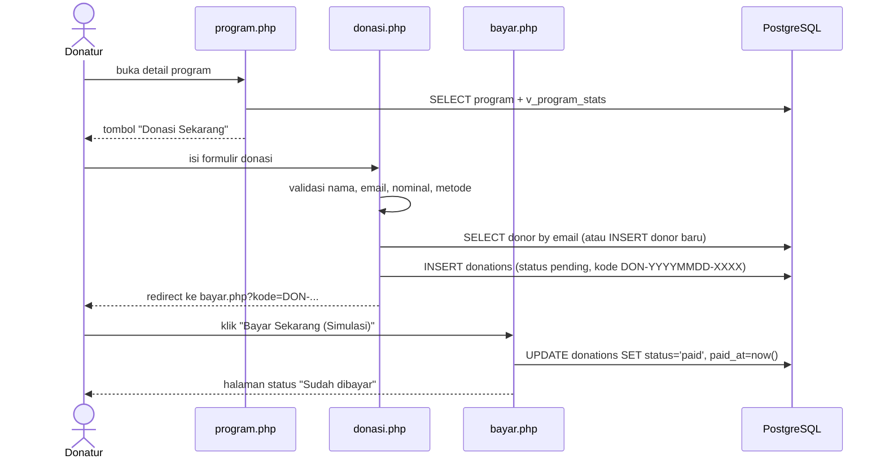
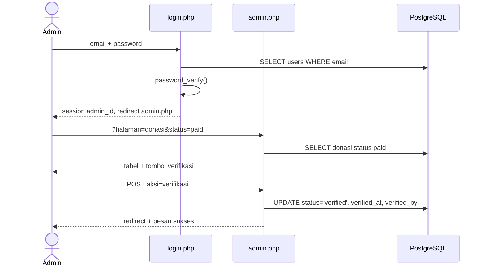

# Alur Aplikasi

Semua halaman adalah file PHP biasa. Tidak ada router, jadi perpindahan halaman
terjadi lewat link (`index.php`, `program.php?id=2`) atau `header('Location: ...')`
setelah proses POST selesai.

## 1. Donatur membuat donasi

Kode donasi dibuat di `donasi.php` dengan format `DON-` + tanggal + 4 karakter acak.
Nomor referensi pembayaran diisi saat baris donasi dibuat, jadi `bayar.php` tinggal
menampilkannya.

## 2. Admin memverifikasi donasi

Kalau ditolak, statusnya jadi `rejected` dan alasannya disimpan di `admin_note`.
Kedua aksi memakai klausa `WHERE status = 'paid'` supaya donasi yang sudah diproses
tidak bisa diubah dua kali.

## 3. Cek status donasi

`cek.php?kode=DON-...` menjalankan satu query JOIN ke `donations`, `donors`, dan
`programs`. Kalau kode tidak ada, halaman menampilkan pesan "kode donasi tidak
ditemukan" dengan status HTTP tetap 200 (bukan error), karena input salah bukan
kesalahan server.

Timeline di halaman ini disusun dari tiga kolom: `created_at`, `paid_at`, dan
`verified_at`.

## 4. Form kontak

Form ada di bagian bawah `index.php`. Setelah validasi, pesan disimpan ke
`contact_messages` lalu pengunjung diarahkan kembali ke `index.php#kontak` dengan
pesan sukses. Pesan muncul di `admin.php?halaman=pesan` dan bisa ditandai sudah
dibaca.

## 5. Login dan hak akses

- `login.php` menyimpan `admin_id`, `admin_nama`, `admin_email` di session.
- `admin.php` memanggil `wajib_login()` di baris atas. Kalau session kosong,
  pengunjung langsung diarahkan ke `login.php`.
- `login.php?keluar=1` mengosongkan session lalu kembali ke form login.
- Tidak ada level user berbeda; semua yang bisa login adalah pengelola.

## 6. Aturan yang berlaku di semua halaman

**Validasi** dilakukan di server, bukan hanya lewat atribut HTML. Contoh: nominal
donasi minimal Rp 10.000, email harus format email, dan pesan kontak minimal 10
karakter.

**CSRF**: setiap form POST menyertakan `csrf_input()`. Sebelum data diproses,
halaman memanggil `csrf_valid()`. Kalau token tidak cocok, proses dibatalkan dan
pengguna melihat pesan "sesi formulir sudah habis".

**Pesan sekali tampil**: `flash()` menyimpan pesan di session, `tampil_flash()`
mencetaknya sekali lalu menghapusnya. Ini sebabnya setelah submit selalu ada
`redirect()` — supaya refresh tidak mengirim ulang data.

**Escape output**: semua data dari database dicetak lewat `e()` agar karakter
seperti `<` dan `"` tidak merusak HTML.
