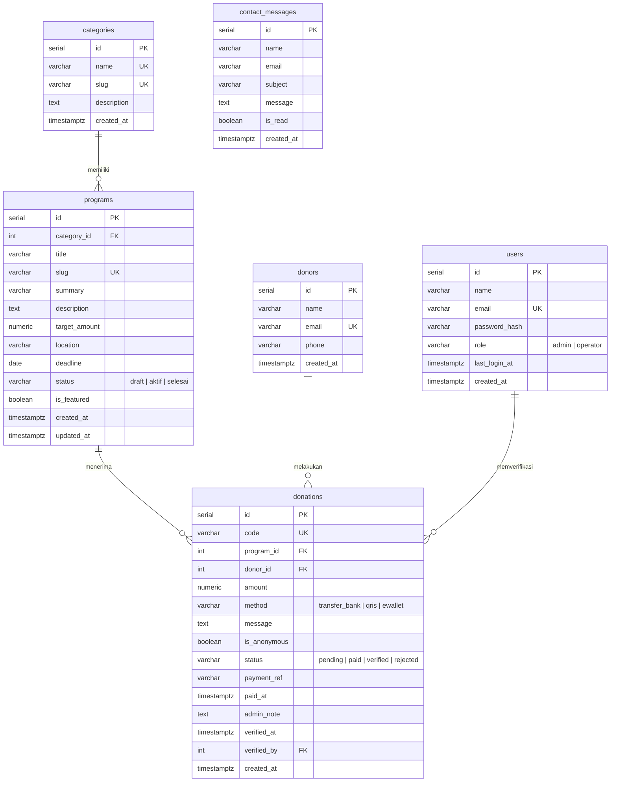

# Database

PostgreSQL 16. Skema didefinisikan di `database/01_schema.sql`, data awal di
`database/02_seed.sql`. Keduanya dijalankan otomatis oleh image PostgreSQL saat
volume database masih kosong.

## 1. ERD



Relasi:

- `programs.category_id → categories.id` — `ON DELETE RESTRICT` (kategori yang masih
  dipakai tidak boleh dihapus).
- `donations.program_id → programs.id` — `ON DELETE RESTRICT`; aplikasi juga menolak
  menghapus program yang sudah punya donasi.
- `donations.donor_id → donors.id` — `ON DELETE RESTRICT`.
- `donations.verified_by → users.id` — `ON DELETE SET NULL` agar riwayat donasi tetap
  utuh bila akun admin dihapus.

## 2. Tabel

### users

Akun pengelola panel admin.

| Kolom | Tipe | Aturan | Keterangan |
|---|---|---|---|
| `id` | `SERIAL` | PK | |
| `name` | `VARCHAR(100)` | NOT NULL | Nama tampilan |
| `email` | `VARCHAR(150)` | NOT NULL, UNIQUE | Dipakai untuk login |
| `password_hash` | `VARCHAR(255)` | NOT NULL | Hasil `password_hash()` (bcrypt) |
| `role` | `VARCHAR(20)` | NOT NULL, CHECK | `admin` atau `operator` |
| `last_login_at` | `TIMESTAMPTZ` | NULL | Diperbarui setiap login berhasil |
| `created_at` | `TIMESTAMPTZ` | NOT NULL, default `now()` | |

### categories

| Kolom | Tipe | Aturan |
|---|---|---|
| `id` | `SERIAL` | PK |
| `name` | `VARCHAR(80)` | NOT NULL, UNIQUE |
| `slug` | `VARCHAR(80)` | NOT NULL, UNIQUE |
| `description` | `TEXT` | NULL |
| `created_at` | `TIMESTAMPTZ` | NOT NULL, default `now()` |

### programs

| Kolom | Tipe | Aturan | Keterangan |
|---|---|---|---|
| `id` | `SERIAL` | PK | |
| `category_id` | `INTEGER` | NOT NULL, FK | |
| `title` | `VARCHAR(150)` | NOT NULL | |
| `slug` | `VARCHAR(170)` | NOT NULL, UNIQUE | Dibuat otomatis dari judul |
| `summary` | `VARCHAR(255)` | NOT NULL | Untuk kartu & meta description |
| `description` | `TEXT` | NOT NULL | Paragraf dipisahkan baris kosong |
| `target_amount` | `NUMERIC(14,2)` | NOT NULL, `> 0` | Target dana |
| `location` | `VARCHAR(120)` | NULL | Kota/kabupaten |
| `deadline` | `DATE` | NULL | Tenggat penggalangan |
| `status` | `VARCHAR(20)` | NOT NULL, CHECK | `draft`, `aktif`, `selesai` |
| `is_featured` | `BOOLEAN` | NOT NULL, default `FALSE` | Tampil di beranda |
| `created_at` | `TIMESTAMPTZ` | NOT NULL | |
| `updated_at` | `TIMESTAMPTZ` | NOT NULL | Diperbarui trigger |

Index: `idx_programs_category`, `idx_programs_status`.

### donors

Satu baris per email. Saat donatur yang sama berdonasi lagi, baris diperbarui
(nama/telepon) melalui `ON CONFLICT (email) DO UPDATE ... RETURNING id`.

| Kolom | Tipe | Aturan |
|---|---|---|
| `id` | `SERIAL` | PK |
| `name` | `VARCHAR(120)` | NOT NULL |
| `email` | `VARCHAR(150)` | NOT NULL, UNIQUE |
| `phone` | `VARCHAR(30)` | NULL |
| `created_at` | `TIMESTAMPTZ` | NOT NULL |

### donations

| Kolom | Tipe | Aturan | Keterangan |
|---|---|---|---|
| `id` | `SERIAL` | PK | |
| `code` | `VARCHAR(30)` | NOT NULL, UNIQUE | Format `DON-YYYYMMDD-XXXX` |
| `program_id` | `INTEGER` | NOT NULL, FK | |
| `donor_id` | `INTEGER` | NOT NULL, FK | |
| `amount` | `NUMERIC(14,2)` | NOT NULL, `>= 10000` | |
| `method` | `VARCHAR(20)` | NOT NULL, CHECK | `transfer_bank`, `qris`, `ewallet` |
| `message` | `TEXT` | NULL | Pesan/doa, ditampilkan bila tidak anonim |
| `is_anonymous` | `BOOLEAN` | NOT NULL, default `FALSE` | Nama disamarkan di publik |
| `status` | `VARCHAR(20)` | NOT NULL, CHECK | `pending`, `paid`, `verified`, `rejected` |
| `payment_ref` | `VARCHAR(40)` | NULL | Nomor referensi dari gateway simulasi |
| `paid_at` | `TIMESTAMPTZ` | NULL | Diisi saat pembayaran disimulasikan |
| `admin_note` | `TEXT` | NULL | Catatan verifikasi/penolakan |
| `verified_at` | `TIMESTAMPTZ` | NULL | Diisi saat status berubah |
| `verified_by` | `INTEGER` | NULL, FK ke `users` | Admin yang memproses |
| `created_at` | `TIMESTAMPTZ` | NOT NULL | |

Index: `idx_donations_program`, `idx_donations_status`, `idx_donations_created`
(`created_at DESC`, untuk daftar terbaru dan laporan).

### contact_messages

| Kolom | Tipe | Aturan |
|---|---|---|
| `id` | `SERIAL` | PK |
| `name` | `VARCHAR(120)` | NOT NULL |
| `email` | `VARCHAR(150)` | NOT NULL |
| `subject` | `VARCHAR(150)` | NOT NULL |
| `message` | `TEXT` | NOT NULL |
| `is_read` | `BOOLEAN` | NOT NULL, default `FALSE` |
| `created_at` | `TIMESTAMPTZ` | NOT NULL |

## 3. View `v_program_stats`

```sql
CREATE VIEW v_program_stats AS
SELECT
    p.id AS program_id,
    p.target_amount,
    COALESCE(SUM(d.amount) FILTER (WHERE d.status = 'verified'), 0) AS collected_amount,
    COUNT(d.id) FILTER (WHERE d.status = 'verified') AS donation_count
FROM programs p
LEFT JOIN donations d ON d.program_id = p.id
GROUP BY p.id;
```

Alasan memakai view: angka "terkumpul" harus selalu konsisten dengan tabel
`donations` dan hanya menghitung donasi `verified`. Halaman `program.php`,
`donasi.php`, dan `admin.php` membaca view ini langsung lewat query, jadi logika
penjumlahan tidak ditulis berulang di tiap halaman.

## 4. Aturan status

**Program**

| Status | Arti | Bisa menerima donasi |
|---|---|---|
| `draft` | Belum dipublikasikan | Tidak |
| `aktif` | Sedang berjalan | Ya |
| `selesai` | Ditutup | Tidak |

**Donasi**

| Status | Arti | Efek pada progress |
|---|---|---|
| `pending` | Donasi dibuat, belum dibayar | Tidak dihitung |
| `paid` | Sudah dibayar di gateway simulasi, menunggu admin | Tidak dihitung |
| `verified` | Pembayaran dikonfirmasi admin | Dihitung |
| `rejected` | Tidak valid / tidak ada bukti | Tidak dihitung |

Perubahan status dilakukan lewat query `UPDATE` di halaman yang berwenang:
`bayar.php` mengubah `pending` menjadi `paid` sambil mengisi `paid_at`, lalu
`admin.php` mengubah `paid` menjadi `verified` atau `rejected` sambil mengisi
`verified_at` dan `verified_by`. Syarat status lama ditulis di klausa `WHERE` supaya
donasi yang sudah diverifikasi tidak bisa diubah lagi.

## 5. Data seed

`database/02_seed.sql` mengisi:

- 1 akun admin: `admin@pedulikasih.test` / `admin123`;
- 4 kategori: Pendidikan, Kesehatan, Kemanusiaan, Lingkungan;
- 6 program contoh (aktif, draft, selesai) dengan variasi target dan tenggat;
- 17 donasi contoh pada rentang Oktober–November 2026 (sebagian besar `verified`,
  satu `pending`, satu `rejected`) agar dashboard dan laporan langsung berisi data.

Semua nama, rekening, dan nomor pada seed bersifat fiktif.

## 6. Query yang sering dipakai

```sql
-- Rekap per program pada rentang tanggal (dipakai laporan)
SELECT p.title,
       c.name AS kategori,
       p.target_amount,
       COALESCE(SUM(d.amount) FILTER (WHERE d.status = 'verified'), 0) AS terkumpul
FROM programs p
JOIN categories c ON c.id = p.category_id
LEFT JOIN donations d ON d.program_id = p.id
       AND d.created_at >= DATE '2026-01-01'
       AND d.created_at < DATE '2026-12-31' + INTERVAL '1 day'
GROUP BY p.id, c.name
ORDER BY terkumpul DESC;

-- Donasi menunggu verifikasi
SELECT code, amount, created_at
FROM donations
WHERE status = 'pending'
ORDER BY created_at;

-- Total dana terverifikasi per bulan (6 bulan terakhir)
SELECT to_char(date_trunc('month', created_at), 'YYYY-MM') AS bulan,
       SUM(amount) AS total
FROM donations
WHERE status = 'verified'
  AND created_at >= date_trunc('month', now()) - INTERVAL '5 months'
GROUP BY 1
ORDER BY 1;
```

## 7. Reset & migrasi

Belum ada sistem migrasi bertingkat; skema bersifat idempotent karena diawali
`DROP ... CASCADE`. Untuk mengulang dari nol:

```bash
docker compose down -v
docker compose up -d
```

Untuk database yang sudah berjalan tanpa kehilangan data lain, impor manual:

```bash
docker compose exec -T db psql -U peduli -d pedulikasih < database/01_schema.sql
docker compose exec -T db psql -U peduli -d pedulikasih < database/02_seed.sql
```

> Perhatian: `01_schema.sql` menghapus tabel yang ada. Jangan jalankan pada database
> berisi data produksi.
